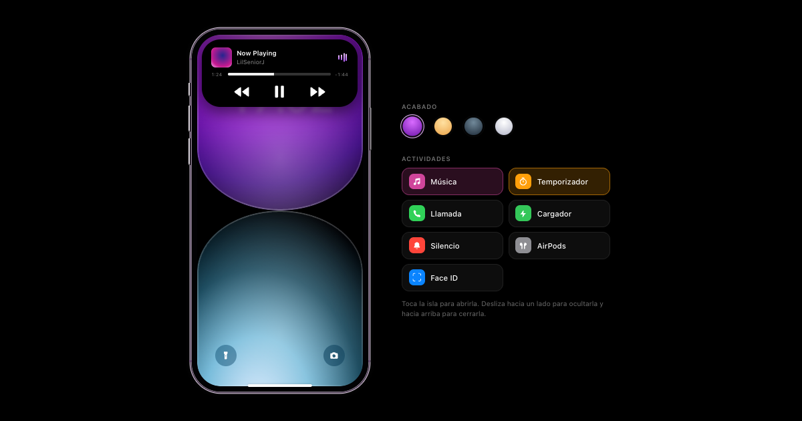

# Dynamic Island

Recreación interactiva de la Dynamic Island del iPhone hecha con HTML, CSS y JavaScript sin dependencias. La isla cambia de forma con animaciones de resorte (*springs*) como las de iOS, muestra varias actividades a la vez y responde a toques y gestos.

**Demo en vivo: [lilseniorj.github.io/Dynamic-island](https://lilseniorj.github.io/Dynamic-island/)**



> Autor: **LilSeniorJ**

## Características

### La isla
- **Cuatro presentaciones**, como en iOS:
  - **Reposo:** píldora negra con la cámara.
  - **Compacta:** la actividad principal a los lados de la cámara.
  - **Expandida:** la actividad abierta, con sus controles.
  - **Alerta:** avisos breves del sistema que aparecen y se van solos.
- **Varias actividades a la vez:** la de más prioridad (llamada, luego temporizador, luego música) ocupa la isla y la segunda aparece en una burbuja separada a la derecha, que sale del borde de la isla con un resorte. Al tocar la burbuja se abre esa actividad.
- **Se recoge como la nativa:**
  - La isla expandida se cierra sola tras 7 s sin interacción, salvo una llamada entrante o un temporizador terminado.
  - Deslizar la isla compacta hacia un lado la oculta: vuelve a la píldora y las actividades siguen en segundo plano. Deslizar otra vez o tocarla las recupera.
- **Animaciones con springs físicos:** la forma rebota al abrirse, se puede interrumpir a mitad de camino y hereda la velocidad del dedo al soltar.
- **Gestos:**
  - Toque para abrir, con un pequeño "squish" al presionar.
  - Arrastrar hacia abajo abre la isla siguiendo el dedo; hacia arriba la cierra o descarta una alerta.
  - Tocar fuera la cierra.

### Actividades
| Actividad | Compacta | Expandida |
| --- | --- | --- |
| **Música** | Carátula y ecualizador con el color de la canción | Reproductor con progreso arrastrable, play/pausa, anterior y siguiente |
| **Temporizador** | Anillo de progreso y cuenta atrás en naranja | Pausar / reanudar y cancelar. Al terminar se abre sola, late en naranja y suena hasta que la detienes o repites |
| **Llamada** | Entrante: contacto y teléfono vibrando. En curso: duración en verde y ondas de voz | Contestar / rechazar; en curso, silenciar micrófono y colgar |

### Alertas del sistema
- **Cargador:** "Cargando" con el porcentaje en verde. Si tu equipo tiene batería y conectas el cargador de verdad, también aparece (Battery API).
- **Modo silencio:** campana tachada en rojo o "Timbre". El modo silencio apaga el sonido del temporizador y el tono de llamada.
- **AirPods:** nombre y anillo de batería que se llena.
- **Face ID:** la isla se vuelve cuadrada, escanea, dibuja el check y el candado de la pantalla de bloqueo se abre.

### Teléfono
- **Botones físicos que funcionan:** el botón de acción (izquierda, arriba) alterna el modo silencio y el botón lateral lanza Face ID.
- Barra de estado con hora real, señal, wifi y batería; se reparte a los lados de la isla y deja sitio a la burbuja.
- Pantalla de bloqueo con candado, fecha, reloj grande y botones de linterna y cámara.
- Sonidos generados con Web Audio (sin archivos) y vibración en móviles Android.
- Cuatro acabados: Deep Purple, Gold, Space Black y Silver. En los fondos claros, la barra de estado pasa a texto oscuro. El color elegido se recuerda entre visitas.
- Panel lateral para lanzar cada actividad y alerta.
- Adaptable: en escritorio el panel va al lado; en móvil, debajo.

### Accesibilidad
- Se puede usar entero con teclado:
  - `Enter`/`Espacio` abre la isla y lleva el foco al primer control.
  - `Esc` la cierra (o descarta la alerta) y devuelve el foco.
  - La barra de progreso es un *slider* que se mueve con las flechas, `Inicio` y `Fin`.
- Con el foco dentro, la isla no se cierra sola.
- Etiquetas ARIA que cambian con el estado, y los cambios importantes (canción, llamada, alertas) se anuncian a lectores de pantalla.
- Respeta `prefers-reduced-motion`.

## Cómo verlo

No necesita instalación. Abre `index.html` en el navegador o sírvelo en local:

```bash
python3 -m http.server 8000
# luego abre http://localhost:8000
```

> Si antes abriste una versión anterior, recarga sin caché (`Cmd + Shift + R`).

**Navegadores:** versiones actuales de Chrome, Edge, Safari y Firefox. Usa `:has()`, `inert`, `color-mix()` y la Web Animations API.

## Deploy en GitHub Pages

Es un sitio estático sin build, así que se publica tal cual desde la rama `main`:

1. Sube los cambios: `git push -u origin main`.
2. En GitHub, abre **Settings → Pages**.
3. En **Build and deployment**, elige **Deploy from a branch**, rama `main` y carpeta `/ (root)`, y guarda.
4. En uno o dos minutos queda en `https://lilseniorj.github.io/Dynamic-island/`.

Cada `push` a `main` vuelve a publicar el sitio. El archivo `.nojekyll` evita que GitHub procese los archivos con Jekyll, y `preview.png` es la imagen que aparece al compartir el enlace.

## Estructura

```
├── index.html   # Teléfono, barra de estado, isla con todas sus vistas y panel lateral
├── style.css    # Estilos y estados visuales (data-island, data-call, data-timer… en .phone)
└── script.js    # Springs, presentación de la isla, gestos, actividades, alertas y reloj
```

## Cómo funciona

### Estado → presentación
`script.js` guarda qué actividades están en marcha, cuál está abierta, si hay una alerta y si el usuario ocultó la isla. La función `layout()` deduce de ahí qué mostrar:

1. Si hay una alerta, se muestra la alerta.
2. Si no, si hay una actividad abierta, la vista expandida.
3. Si no, la actividad de más prioridad en compacta y la segunda en la burbuja.
4. Si no hay ninguna, reposo.

El resultado se refleja en `data-island` sobre `.phone` y en la clase `.is-shown` de la vista visible. Así el CSS solo se encarga de cómo se ve cada estado.

### Springs
El ancho, el alto, el radio, la escala, el desplazamiento y la burbuja son *springs* físicos calculados en cada frame. Se configuran como en SwiftUI con dos valores:

- `response`: cuánto dura la animación.
- `damping`: cuánto rebota (1 = sin rebote).

Por eso una animación se puede interrumpir y la velocidad de un gesto pasa directamente a la animación al soltar.

### Contenido sin saltos
Cada vista expandida o de alerta tiene siempre su tamaño final y está centrada. La isla la va recortando (`overflow: hidden`) mientras crece, así el contenido no se reacomoda durante la animación.

## Personalizar

- **Canciones:** el arreglo `tracks` en `script.js`.
- **Duración del temporizador:** `startTimer(60)` en `demoActions` (en segundos).
- **Tamaños de cada presentación:** el objeto `SIZES` en `script.js`.
- **Sensación de las animaciones:** `motionFor()` en `script.js`.
- **Tiempo de cierre automático:** `AUTO_COLLAPSE_MS`.

## Próximos pasos

- [ ] Audio real con `<audio>` y Media Session API.
- [ ] Más actividades: navegación, grabación de pantalla, Apple Pay.
- [ ] Efecto "goo" al separarse la burbuja de la isla.
- [x] Deploy en GitHub Pages.
